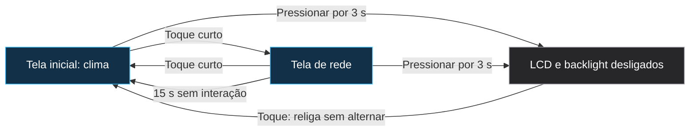
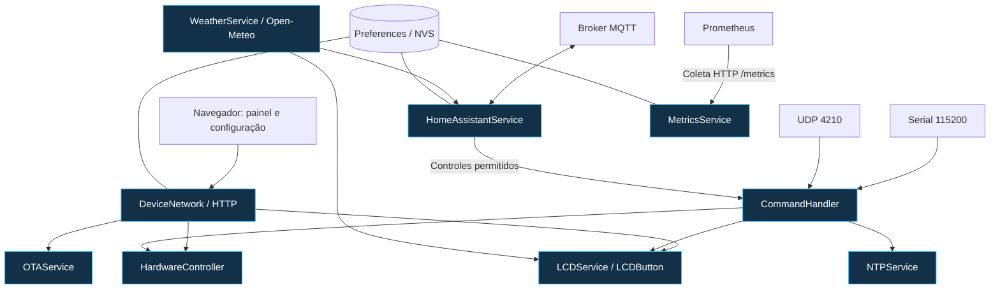
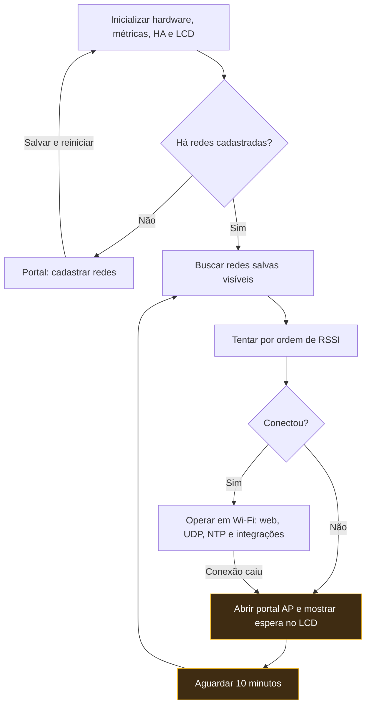
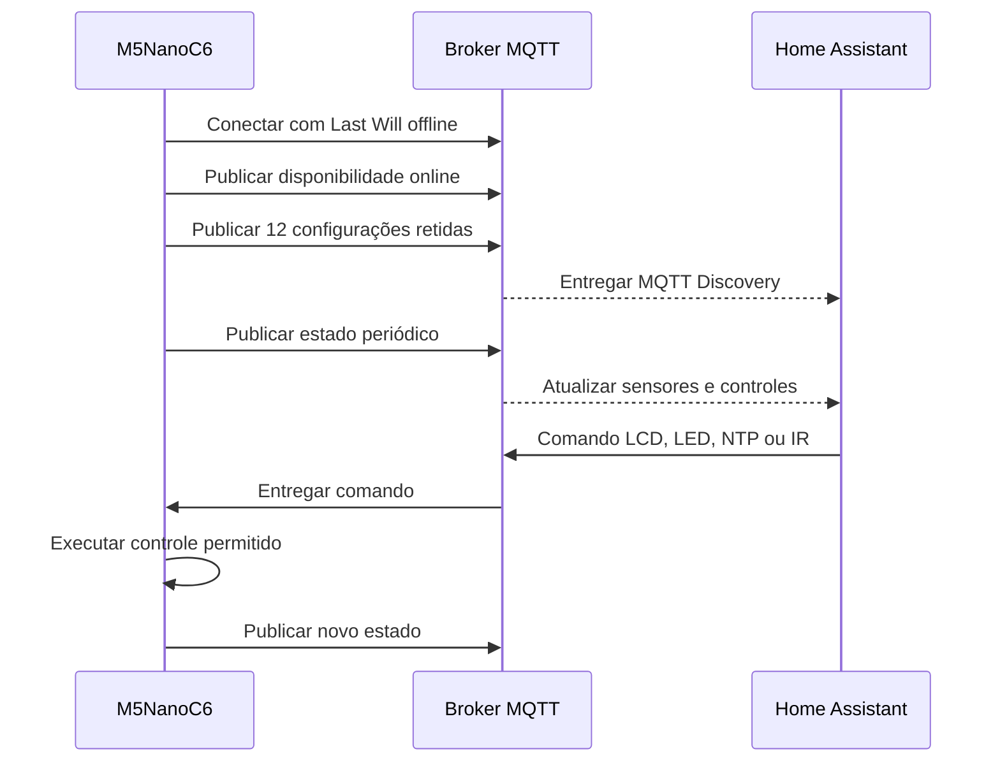
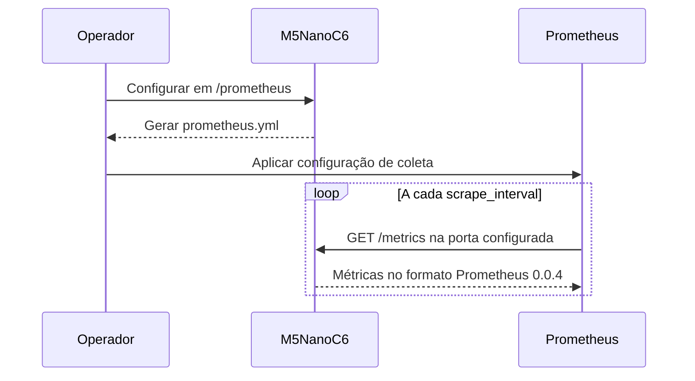
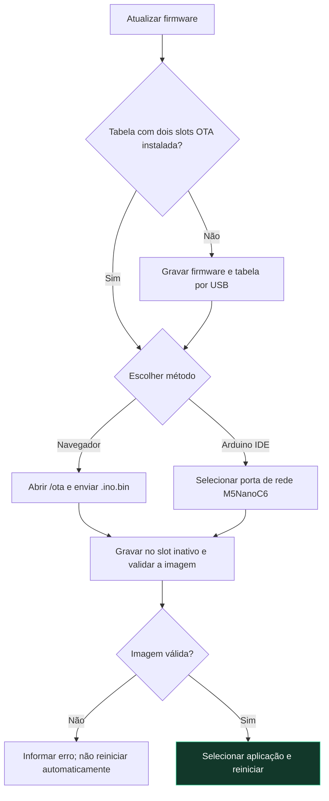

<div align="center">

# M5NanoC6

### Clima, automação e observabilidade em um ESP32-C6.

Um firmware com LCD 20×4, painel web, atualização por Wi-Fi e integração com sua casa conectada.


**[Começar](#comecar) · [Hardware](#hardware) · [Fluxos](#fluxos) · [Comandos](#comandos) · [Documentação](#documentacao)**

</div>

---

> **Uma placa, várias interfaces.** Consulte o clima no LCD, controle pela web ou por UDP/Serial, acompanhe as métricas no Prometheus e encontre o dispositivo no Home Assistant por MQTT Discovery.

<a id="visao-geral"></a>
## ✨ O que o projeto entrega

| Experiência | Recursos |
| :--- | :--- |
| **Clima à vista** | Data/hora, temperatura atual, máxima/mínima, umidade e condição do tempo de Porto Alegre, com ícones e rolagem no LCD. |
| **Rede resiliente** | Até cinco redes salvas, prioridade por RSSI, portal de configuração e novas tentativas a cada 10 minutos quando desconectado. |
| **Controle local** | Painel web, API JSON, comandos UDP/Serial, botão físico, LED RGB e pulso infravermelho. |
| **Casa conectada** | 12 entidades por MQTT Discovery: controles, botões de ação e sensores. |
| **Observabilidade** | Endpoint Prometheus com dados de sistema, Wi-Fi, memória, clima, GPIO, HTTP, UDP e MQTT. |
| **Atualização pela rede** | Upload web com barra de progresso e ArduinoOTA com descoberta mDNS na IDE. |

**Estado atual:** Bluetooth desativado; OTA web e ArduinoOTA sem senha; configurações persistidas em Preferences/NVS. O clima é externo, obtido do Open-Meteo — não de um sensor ambiental instalado na placa.

<a id="comecar"></a>
## 🚀 Comece aqui

### 1. Prepare o ambiente

- **Placa:** M5Stack NanoC6, baseada no ESP32-C6, com flash de 4 MiB.
- **Ferramentas:** Arduino IDE ou Arduino CLI com o core **Arduino ESP32 3.3.12**, usado no projeto.
- **Bibliotecas:** ArduinoJson **7.4.3**, PubSubClient **2.8** e Adafruit NeoPixel.
- **Incluídas no core:** Wire, WiFi, WebServer, Preferences, Update, ArduinoOTA, HTTPClient e NetworkClientSecure.
- **LCD:** 20×4 com backpack PCF8574T. A placa também funciona sem o display.

### 2. Compile e faça a primeira gravação por USB

Abra [`M5NanoC6_wifi.ino`](M5NanoC6_wifi.ino) e mantenha [`partitions.csv`](partitions.csv) na mesma pasta do sketch. A primeira instalação da tabela OTA exige gravação por USB.

**Pela CLI**, execute na pasta que contém o `.ino`:

```bat
arduino-cli compile --fqbn esp32:esp32:m5stack_nanoc6:PartitionScheme=default --build-property "upload.maximum_size=1966080" --build-path "../build" .
arduino-cli upload --fqbn esp32:esp32:m5stack_nanoc6:PartitionScheme=default --port COM5 --input-dir "../build" .
```

Substitua `COM5` pela porta da placa. Os exemplos pressupõem core e bibliotecas já instalados.

<details>
<summary><strong>Atalhos do workspace Windows e uso da Arduino IDE</strong></summary>

No workspace que contém `compilar.cmd` e `Makefile`, execute a partir da pasta desses arquivos:

```bat
compilar.cmd
compilar.cmd size
```

Com GNU Make instalado:

```bat
make
make size
make JOBS=4
```

O script mantém os objetos para compilação incremental e aplica o limite correto da partição. Não compile simultaneamente no mesmo diretório de saída.

Na IDE, selecione **M5Stack NanoC6**. O CSV do sketch define as duas partições OTA; a opção de menu pode informar um limite diferente. O guia [OTA](OTA.md) explica a seleção da partição, inclusive o uso de Huge APP quando necessário para compilar na IDE, e a conferência do tamanho real.

</details>

> [!IMPORTANT]
> Cada aplicação OTA tem **1.966.080 bytes (1,875 MiB)**. Compare o binário com esse limite, não com os 4 MiB totais da flash. Não use a imagem `merged`, o bootloader ou a tabela de partições como arquivo de aplicação OTA.

### 3. Cadastre sua rede

Sem conexão, a placa abre a rede **`M5NanoC6_CONFIG`**. Conecte-se a ela e abra o IP do portal mostrado no LCD; acesse `/config` para salvar até cinco redes. O firmware reinicia após salvar.

Conectado ao Wi-Fi, abra **`http://IP_DO_ESP32/info`**. O IP também está disponível no LCD, na Serial e pelo comando `IP`.

### 4. Ative as integrações desejadas

| Quero… | Onde configurar |
| :--- | :--- |
| Usar o Home Assistant | `/homeassistant`: informe o broker MQTT, credenciais opcionais e ative a integração. |
| Coletar métricas | `/prometheus`: configure a coleta e aplique o YAML gerado ao servidor Prometheus. |
| Atualizar o firmware pelo navegador | `/ota`: envie `M5NanoC6_wifi.ino.bin` e acompanhe o progresso. |
| Atualizar pela Arduino IDE | Procure a porta de rede **M5NanoC6**, depois que esta versão estiver instalada. |

<a id="hardware"></a>
## 🔌 Hardware e ligação

| Componente | Sinal | GPIO / conector |
| :--- | :--- | :--- |
| LCD PCF8574T | SDA | **GPIO2 · G2** |
| LCD PCF8574T | SCL | **GPIO1 · G1** |
| Botão integrado | Entrada ativa em nível baixo | GPIO9 |
| LED RGB | Dados NeoPixel | GPIO20 |
| LED RGB | Habilitação | GPIO19 |
| LED azul | Saída digital | GPIO7 |
| Infravermelho | Transmissão de pulso | GPIO3 |

O driver LCD é local, usa apenas Wire e detecta um único PCF8574 entre **0x20 e 0x27**. Para endereço fixo, ajuste `Config::LCD_ENDERECO` em [`Config.h`](Config.h).

**Ligação elétrica:** use terra comum. Se o backpack estiver alimentado em 5 V com pull-ups para 5 V, use conversor bidirecional I²C de 3,3 V/5 V. Ajuste o potenciômetro de contraste se o backlight acender sem mostrar caracteres.

<a id="lcd"></a>
## 🖥️ Duas telas, um botão

| Linha | Início · clima | Rede |
| :---: | :--- | :--- |
| **1** | Calendário, data e hora | Estado Wi-Fi ou portal AP |
| **2** | Máxima e mínima com ícones | IP da estação ou do portal |
| **3** | Temperatura atual e **💧 umidade** | Nome da rede |
| **4** | Ícone e descrição do clima | RSSI e canal |

Os ícones são desenhados na memória CGRAM do LCD. Nomes de rede e descrições longas usam rolagem; a prévia web representa os ícones por símbolos Unicode.



O toque curto é aplicado ao soltar o botão; segurar não repete a ação. O debounce é de **35 ms**. Durante a espera de reconexão, a última linha mostra a contagem regressiva; durante a tentativa, o LCD destaca busca, SSID e conexão concluída. A tela desligada permanece apagada.

| Atualização | Intervalo |
| :--- | :--- |
| Conteúdo do LCD | 1 segundo no loop normal |
| Consulta de clima | 10 minutos |
| Nova consulta após falha | 2 minutos |
| Validade máxima do clima em cache | 30 minutos |
| Retorno da tela de rede | 15 segundos sem interação |

`*` junto da temperatura indica dados anteriores após falha ou queda de Wi-Fi. Máxima e mínima correspondem ao dia de Porto Alegre; valores indisponíveis aparecem como `--`.

<a id="fluxos"></a>
## 🧭 Arquitetura e fluxos

### Como os serviços se conectam



### Boot, falha de rede e reconexão



Conectado, o firmware mantém a rede e não faz buscas periódicas. A reconexão automática do core está desativada para respeitar o agendamento. Sem redes cadastradas, o portal permanece disponível sem agendar tentativas.

**Limite operacional:** o agendamento da espera não bloqueia o loop, mas a busca e as tentativas de conexão ainda são bloqueantes. Elas podem atrasar botões e atendimento web; o portal AP é temporariamente interrompido durante a rodada e retorna em caso de falha.

<a id="interfaces"></a>
## 🌐 Interfaces e portas

| Interface | Endereço / porta | Uso |
| :--- | :--- | :--- |
| Painel | HTTP **80** · `/info` | Diagnóstico e controles |
| Redes Wi-Fi | HTTP **80** · `/config` | Cadastro das redes |
| Home Assistant | HTTP **80** · `/homeassistant` | Configuração MQTT |
| Prometheus | HTTP **80** · `/prometheus` | Configuração e YAML de coleta |
| OTA web | HTTP **80** · `/ota` | Upload de aplicação |
| API | HTTP **80** · `/api/status` | Estado do dispositivo |
| Métricas | `/metrics` · **80 por padrão**, configurável | Coleta Prometheus |
| Comandos UDP | **4210** | Requisição e resposta ao remetente |
| Comandos Serial | **115200 baud** | Linhas LF ou CRLF |
| ArduinoOTA | **3232** | Upload pela IDE |
| Descoberta ArduinoOTA | mDNS · hostname **M5NanoC6** | Porta de rede na IDE |
| MQTT | **1883 por padrão**, configurável | Conexão ao broker, sem TLS |

> [!NOTE]
> A porta configurada para Prometheus altera somente o servidor de `/metrics`. **Painel, API e OTA web continuam na porta 80.** Se a porta de métricas também for 80, os serviços compartilham o servidor HTTP.

<details>
<summary><strong>Rotas de configuração e ações</strong></summary>

| Método | Rota | Função |
| :--- | :--- | :--- |
| GET | `/api/prometheus/config` | Lê preferências e YAML de coleta |
| POST | `/api/prometheus/config` | Salva host, porta de métricas e intervalo |
| GET | `/prometheus.yml` | Baixa a configuração de coleta |
| GET | `/api/homeassistant/config` | Lê configuração pública e estado MQTT |
| POST | `/api/homeassistant/config` | Salva broker, credenciais e ativação |
| POST | `/salvar` | Salva redes Wi-Fi e reinicia |
| POST | `/ntp_sync` | Solicita sincronização NTP |
| POST | `/set_fuso` | Ajusta fuso e horário de verão |
| POST | `/scan_wifi` | Mede sinais das redes salvas |
| POST | `/lcd_on`, `/lcd_off` | Liga/desliga o LCD |
| GET | `/led_on`, `/led_off`, `/ir_tx` | Controles de LED e pulso IR |
| GET | `/reboot` | Reinicia o dispositivo |

</details>

<a id="comandos"></a>
## ⌨️ Comandos de operação

UDP e Serial aceitam comandos em maiúsculas ou minúsculas. A resposta retorna pelo canal de origem. Na Serial, use LF/CRLF e até **255 caracteres ASCII** por linha.

| Grupo | Comandos |
| :--- | :--- |
| Descoberta e diagnóstico | `HELP`, `NAME`, `ALIVE`, `INFO`, `STATUS`, `VERSION`, `BUILD`, `REASON` |
| Rede | `IP`, `MAC`, `RSSI`, `NET_INFO` |
| Sistema | `TEMP`, `CPU`, `RAM`, `HEAP`, `FLASH`, `UPTIME` |
| Relógio | `TIME`, `DATE`, `NTP_SYNC`, `NTP_STATUS`, `SET_FUSO:N`, `DST_ON`, `DST_OFF` |
| LCD | `LCD_ON`, `LCD_OFF` |
| LED e IR | `LED_ON`, `LED_OFF`, `LED_BLINK[:ms]`, `SET_RGB:R,G,B`, `SET_BREATH:R,G,B,MS`, `IR_TX` |
| Home Assistant | `HA_STATUS`, `HA_DISCOVERY`, `HA_USER`, `HA_PASSWORD` |
| Administração | `REBOOT`, `RESET_WIFI`, `RESET_COUNTERS` |

`HELP` começa com `COMANDOS` e lista um comando por linha, facilitando o parser. `HA_DISCOVERY` agenda a republicação das entidades; acompanhe pelo `HA_STATUS`.

**Credenciais:** `HA_PASSWORD` devolve a senha MQTT em texto pelo canal solicitado. A API web não devolve essa senha. `RESET_WIFI` apaga as redes; `RESET_COUNTERS` zera os contadores NVS de boot/watchdog. Detalhes em [COMANDOS.md](COMANDOS.md).

<a id="integracoes"></a>
## 🏠 Home Assistant e Prometheus

### Home Assistant · MQTT Discovery

Configure o **broker MQTT**, que pode estar em outra máquina, e ative a integração em `/homeassistant`. O endereço web do HA e sua porta 8123 não substituem o endereço/porta do broker.

| Tipo | Entidades |
| :--- | :--- |
| 2 switches | Tela LCD e LED RGB |
| 2 botões | Sincronizar NTP e emitir pulso IR |
| 4 sensores de sistema | Temperatura CPU, heap livre, uptime e RSSI |
| 4 sensores de clima | Temperatura, umidade, máxima e mínima de Porto Alegre |

A identidade deriva da MAC: `m5nanoc6_<mac>`. Discovery usa o prefixo `homeassistant`; Last Will sinaliza indisponibilidade. Credenciais e intervalo ficam nas prefs. Comandos MQTT não são retidos e se limitam aos controles anunciados.



Guia: [HOME_ASSISTANT.md](HOME_ASSISTANT.md).

### Prometheus · coleta direta

O Prometheus consulta o ESP32 por HTTP. Salvar as preferências gera o YAML, mas **não altera o servidor Prometheus automaticamente**. Aplique o job ao servidor e reserve um IP para a placa no DHCP.



| Área | Exemplos de métricas |
| :--- | :--- |
| Disponibilidade e sistema | `esp_status_online`, `esp_uptime_seconds`, `esp_boot_count` |
| Rede e memória | `esp_wifi_rssi_dbm`, `esp_heap_free_bytes`, `esp_flash_usage_percent` |
| UDP | `esp_udp_listener_up`, `esp_udp_packets_received_total`, `esp_udp_replies_sent_total`, `esp_udp_send_errors_total` |
| MQTT | `mqtt_connected`, `mqtt_messages_sent`, `mqtt_messages_received`, `mqtt_publish_errors` |
| Clima | `sensor_temperature_celsius`, `sensor_humidity_percent` |
| HTTP | `application_requests_total`, `application_errors_total`, `application_response_time_ms` |

Use `up` do Prometheus para detectar um dispositivo inacessível. Métricas de energia, bateria, relés, pressão, qualidade do ar e ADC sem implementação não são inventadas. Catálogo e semântica: [PROMETHEUS.md](PROMETHEUS.md).

<a id="ota"></a>
## 🔄 OTA: da primeira gravação às próximas

**Primeira instalação ou migração da tabela:** USB, incluindo as partições. **Atualizações seguintes:** página web ou porta de rede ArduinoOTA.



Na página web, a barra mostra **envio → validação → reinício**. Upload concluído não significa imagem aprovada; aguarde a confirmação. Na IDE, use o progresso nativo do upload. Ambos os métodos compartilham o mecanismo de atualização: não os utilize simultaneamente.

**Acesso local:** OTA está sem senha, conforme a configuração do projeto. Não há HTTPS nem rollback automático após falha de execução do novo firmware. Credenciais MQTT são independentes dessa configuração. Procedimentos e recuperação: [OTA.md](OTA.md).

### Mapa da flash · 4 MiB

| Região | Offset | Tamanho |
| :--- | :--- | :--- |
| NVS / Preferences | `0x9000` | `0x5000` · 20 KiB |
| Dados OTA | `0xE000` | `0x2000` · 8 KiB |
| Aplicação 0 | `0x10000` | `0x1E0000` · **1.966.080 bytes** |
| Aplicação 1 | `0x1F0000` | `0x1E0000` · **1.966.080 bytes** |
| SPIFFS | `0x3D0000` | `0x20000` · 128 KiB |
| Coredump | `0x3F0000` | `0x10000` · 64 KiB |

Fonte: [`partitions.csv`](partitions.csv). A tabela acima lista as partições; os endereços anteriores à NVS são reservados ao bootloader e à tabela. Cada firmware precisa caber em **um** slot.

<a id="codigo"></a>
## 🧩 Organização do código

| Arquivos | Responsabilidade |
| :--- | :--- |
| [`M5NanoC6_wifi.ino`](M5NanoC6_wifi.ino) | Inicialização e execução dos serviços |
| [`Config.h`](Config.h), [`HardwareController.h`](HardwareController.h) | Pinos, padrões e controle de LED/IR |
| [`DeviceNetwork.h`](DeviceNetwork.h), [`WiFiRetryPolicy.h`](WiFiRetryPolicy.h) | Redes, portal, HTTP, UDP e agendamento de reconexão |
| [`CommandHandler.h`](CommandHandler.h) | Comandos e respostas por canal |
| [`LCDService.h`](LCDService.h), [`LCDButton.h`](LCDButton.h) | Driver, ícones, telas e interação do botão |
| [`NTPService.h`](NTPService.h), [`WeatherService.h`](WeatherService.h) | Hora local e consultas meteorológicas |
| [`OTAService.h`](OTAService.h), [`OTAUploadPage.h`](OTAUploadPage.h) | Atualização web e ArduinoOTA |
| [`MetricsService.h`](MetricsService.h), [`MetricsPage.h`](MetricsPage.h) | Métricas e configuração da coleta |
| [`HomeAssistantService.h`](HomeAssistantService.h), [`HomeAssistantPage.h`](HomeAssistantPage.h) | MQTT, Discovery e configuração |
| [`WebDashboard.h`](WebDashboard.h) | Painel web e prévia do LCD |

### Persistência

| Namespace NVS | Conteúdo |
| :--- | :--- |
| `m5wifi` | Redes, último índice de conexão e ajustes de relógio |
| `telemetry` | Configuração Prometheus e contadores persistentes |
| `m5ha` | Configuração e credenciais MQTT |

Estado ligado/desligado e página do LCD não são persistidos. Contadores HTTP, UDP e MQTT reiniciam com o firmware; boot/watchdog usam NVS conforme o catálogo de métricas.

<a id="validacao"></a>
## 🧪 Validação e limites

O workspace de desenvolvimento inclui testes locais de métricas, MQTT Discovery, formulário web, OTA, LCD, botão e política de reconexão, com adaptadores simulados. Eles verificam lógica e formato; **não substituem compilação com o SDK nem testes na placa, no broker e na rede reais**.

Os badges identificam a plataforma e as integrações do projeto. Confira o tamanho do firmware no binário recém-compilado.

<a id="documentacao"></a>
## 📚 Guias do projeto

| Guia | Conteúdo |
| :--- | :--- |
| [Comandos](COMANDOS.md) | Sintaxe, exemplos, LCD, redes e operação |
| [OTA](OTA.md) | USB inicial, upload web, ArduinoOTA e partições |
| [Prometheus](PROMETHEUS.md) | Configuração, catálogo de métricas e diagnóstico |
| [Home Assistant](HOME_ASSISTANT.md) | Broker, Discovery, entidades e credenciais |
| [Changelog](CHANGELOG.md) | Evolução do firmware e das verificações |

---

<div align="center">

**M5NanoC6 · clima na tela, controle na rede, dados nas suas ferramentas.**

[Voltar ao início](#m5nanoc6)

</div>
