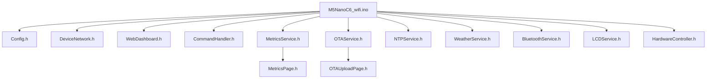
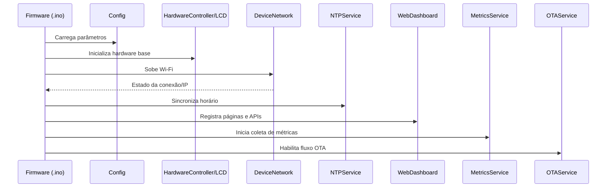
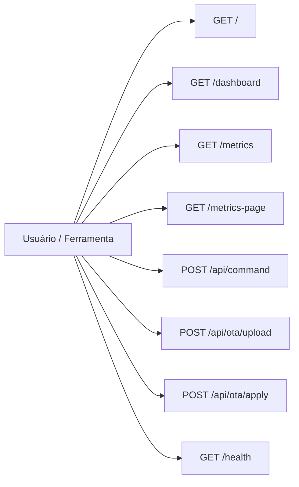
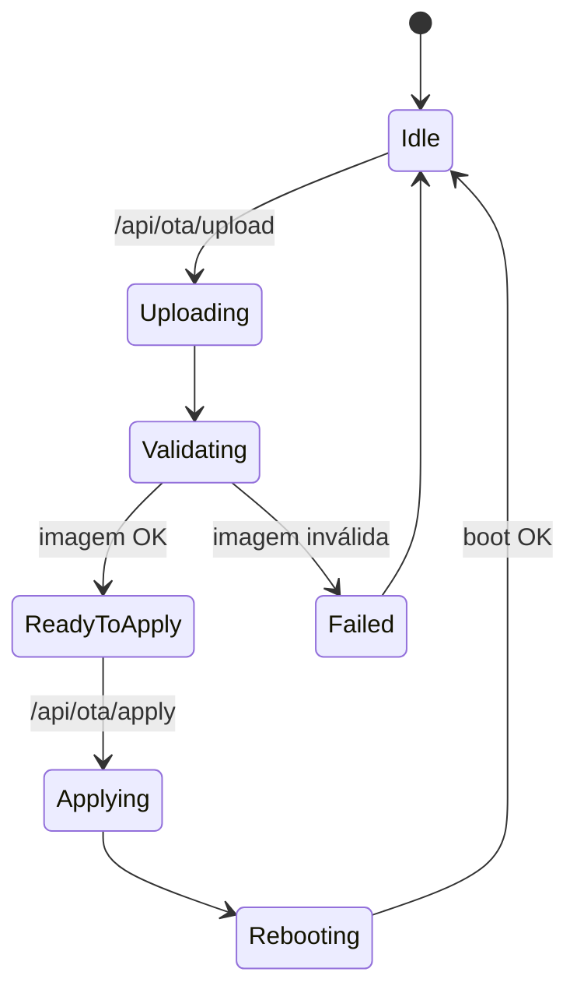
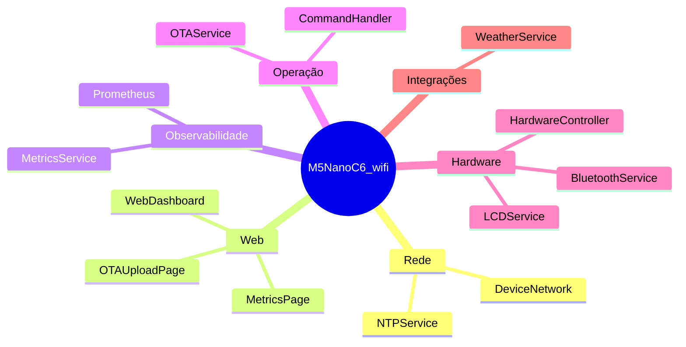

# M5NanoC6_wifi — Documentação Técnica Completa

Firmware modular para **M5 Nano C6 (ESP32-C6)** com foco em:
- conectividade Wi-Fi,
- dashboard web local,
- métricas/observabilidade,
- OTA (atualização remota),
- comandos operacionais,
- integrações auxiliares (NTP, clima, Bluetooth, LCD).

---

## Sumário

1. [Identidade do repositório](#1-identidade-do-repositório)
2. [Arquitetura em alto nível](#2-arquitetura-em-alto-nível)
3. [Inventário completo de arquivos-fonte](#3-inventário-completo-de-arquivos-fonte-diretório-raiz)
4. [Detalhamento técnico por arquivo-fonte](#4-detalhamento-técnico-por-arquivo-fonte)
5. [API / rotas prováveis](#5-api--rotas-prováveis)
6. [Build, gravação e validação](#6-build-gravação-e-validação-guia-rápido)
7. [Observabilidade e operação contínua](#7-observabilidade-e-operação-contínua)
8. [Segurança mínima recomendada](#8-segurança-mínima-recomendada)
9. [Arquivos de documentação complementares](#9-arquivos-de-documentação-complementares-no-repositório)
10. [Próximos upgrades recomendados](#10-próximos-upgrades-recomendados)
11. [Licença](#licença)

---

## 1) Identidade do repositório

- **Repositório:** `paulocfmarques-collab/M5NanoC6_wifi`
- **URL:** https://github.com/paulocfmarques-collab/M5NanoC6_wifi
- **Branch padrão:** `main`
- **Linguagem principal:** C++
- **Plataforma-alvo:** ESP32-C6 (Arduino framework)
- **Entrypoint:** `M5NanoC6_wifi.ino`

---

## 2) Arquitetura em alto nível

O projeto segue uma abordagem modular, com serviços especializados em headers C++ e um orquestrador principal em `.ino`.

### 2.1 Mapa de componentes

### 2.2 Sequência de boot

### 2.3 Fluxo de execução

1. Boot do firmware (`setup` no `.ino`)
2. Carregamento de parâmetros (`Config.h`)
3. Inicialização de hardware básico (`HardwareController.h`, `LCDService.h`)
4. Conexão de rede (`DeviceNetwork.h`)
5. Sincronização de tempo (`NTPService.h`)
6. Subida de endpoints/páginas (`WebDashboard.h`, `MetricsPage.h`, `OTAUploadPage.h`)
7. Loop principal (`loop`) com:
   - manutenção de conectividade,
   - coleta e exposição de métricas,
   - processamento de comandos,
   - supervisão de OTA.

---

## 3) Inventário completo de arquivos-fonte (diretório raiz)

> Escopo desta seção: **arquivos de código/configuração** utilizados pelo firmware.

| Arquivo | Função principal | Tamanho (bytes) |
|---|---|---:|
| `M5NanoC6_wifi.ino` | Orquestração de setup/loop da aplicação | 3080 |
| `Config.h` | Definições globais de configuração e parâmetros | 4850 |
| `DeviceNetwork.h` | Gerenciamento Wi-Fi, estado de rede e reconexão | 32646 |
| `WebDashboard.h` | Dashboard web local e rotas de interface | 24901 |
| `CommandHandler.h` | Processamento e roteamento de comandos | 14622 |
| `MetricsService.h` | Coleta e exposição de métricas | 13660 |
| `MetricsPage.h` | Página de visualização de métricas | 6211 |
| `OTAService.h` | Serviço de atualização OTA | 6934 |
| `OTAUploadPage.h` | Página de upload de firmware OTA | 3426 |
| `NTPService.h` | Sincronização de horário via NTP | 3713 |
| `WeatherService.h` | Integração de dados de clima | 11595 |
| `BluetoothService.h` | Recursos de conectividade/interação Bluetooth | 6952 |
| `LCDService.h` | Renderização/controle de display LCD | 5745 |
| `HardwareController.h` | Acesso e controle de periféricos/IO | 5971 |
| `partitions.csv` | Layout de partições da flash (ESP32) | 304 |

---

## 4) Detalhamento técnico por arquivo-fonte

## `M5NanoC6_wifi.ino`
**Papel:** ponto de entrada do firmware.  
**Responsabilidades prováveis:**
- incluir/instanciar serviços,
- inicialização geral em `setup()`,
- ciclo de manutenção em `loop()`.

## `Config.h`
**Papel:** centralizar parâmetros de build/runtime.  
**Conteúdo esperado:** SSID/senha, timeouts, flags de debug, endpoints e limites.

## `DeviceNetwork.h`
**Papel:** camada de conectividade.  
**Responsabilidades:** iniciar Wi-Fi, monitorar link/RSSI, reconectar, manter estado de IP.

## `WebDashboard.h`
**Papel:** interface web local para operação.  
**Responsabilidades:** servir páginas HTML e handlers HTTP de status/controle.

## `CommandHandler.h`
**Papel:** barramento de comandos operacionais.  
**Responsabilidades:** validar payload, despachar ações e responder com status padronizado.

## `MetricsService.h`
**Papel:** observabilidade técnica.  
**Responsabilidades:** coletar e expor métricas (uptime, memória, Wi-Fi, erros).

## `MetricsPage.h`
**Papel:** visualização humana de métricas.  
**Responsabilidades:** renderizar painel de monitoramento para troubleshooting rápido.

## `OTAService.h`
**Papel:** motor de atualização OTA.  
**Responsabilidades:** receber imagem, validar, aplicar e coordenar reboot.

## `OTAUploadPage.h`
**Papel:** interface web para upload OTA.  
**Responsabilidades:** envio do firmware e feedback de progresso/erro.

## `NTPService.h`
**Papel:** sincronização de relógio via NTP.  
**Impacto:** timestamps confiáveis para logs e métricas.

## `WeatherService.h`
**Papel:** integração de clima.  
**Responsabilidades:** consulta de fonte externa, cache e fallback.

## `BluetoothService.h`
**Papel:** camada Bluetooth/BLE complementar ao Wi-Fi.  
**Cuidados:** concorrência de rádio e consumo energético.

## `LCDService.h`
**Papel:** exibição local no display.  
**Responsabilidades:** status operacional e mensagens de alerta.

## `HardwareController.h`
**Papel:** abstração de hardware/periféricos.  
**Benefício:** reduz acoplamento e facilita evolução da base.

## `partitions.csv`
**Papel:** layout da flash do ESP32-C6.  
**Crítico para OTA:** precisa manter partição adequada para app e atualização.

---

## 5) API / rotas prováveis

> Rotas inferidas da estrutura dos módulos; ajuste conforme implementação real.

### 5.1 Mapa visual de rotas

### 5.2 Páginas web

- `GET /` — dashboard inicial
- `GET /dashboard` — visão geral
- `GET /metrics-page` — métricas human-readable
- `GET /ota` — upload de firmware

### 5.3 API de estado/métricas

- `GET /health` — health check
- `GET /status` — snapshot JSON
- `GET /metrics` — endpoint para scraping/Prometheus

### 5.4 API operacional

- `POST /api/command` — comandos gerais
- `POST /api/reboot` — reboot
- `POST /api/wifi/reconnect` — reconexão de rede
- `POST /api/time/sync` — sincronização NTP

### 5.5 API OTA

- `GET /api/ota/status`
- `POST /api/ota/upload`
- `POST /api/ota/apply`
- `POST /api/ota/cancel`

### 5.6 Estado OTA (conceitual)

---

## 6) Build, gravação e validação (guia rápido)

1. Instalar suporte ESP32 com alvo ESP32-C6.
2. Abrir `M5NanoC6_wifi.ino`.
3. Revisar `Config.h`.
4. Confirmar `partitions.csv` compatível com OTA.
5. Compilar e gravar.
6. Validar:
   - Wi-Fi conectado,
   - dashboard acessível,
   - NTP sincronizado,
   - métricas disponíveis,
   - OTA funcional.

---

## 7) Observabilidade e operação contínua

### 7.1 Domínios de observação

### 7.2 Itens para monitorar

- uptime,
- RSSI,
- memória livre,
- taxa de erro por módulo,
- status NTP e OTA.

---

## 8) Segurança mínima recomendada

Para endpoints críticos (`/api/command`, OTA):
- token/chave de API,
- restrição a LAN,
- validação rígida de payload e firmware,
- logs de auditoria para comandos sensíveis.

---

## 9) Arquivos de documentação complementares no repositório

Além dos fontes, o projeto inclui:

- `CHANGELOG.md` e `CHANGELOG.pdf`
- `COMANDOS.md` e `COMANDOS.pdf`
- `OTA.md` e `OTA.pdf`
- `PROMETHEUS.md` e `PROMETHEUS.pdf`

---

## 10) Próximos upgrades recomendados

- diagrama oficial de arquitetura com contratos entre módulos,
- tabela completa de parâmetros de `Config.h`,
- seção de troubleshooting por sintoma,
- padronização de resposta JSON para todas as rotas,
- matriz de compatibilidade de versões (board/framework/libs).

---

## Licença

Nenhum arquivo `LICENSE` foi identificado na raiz durante este levantamento.  
Recomendado adicionar uma licença explícita para definir uso/distribuição.
