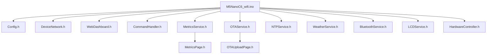
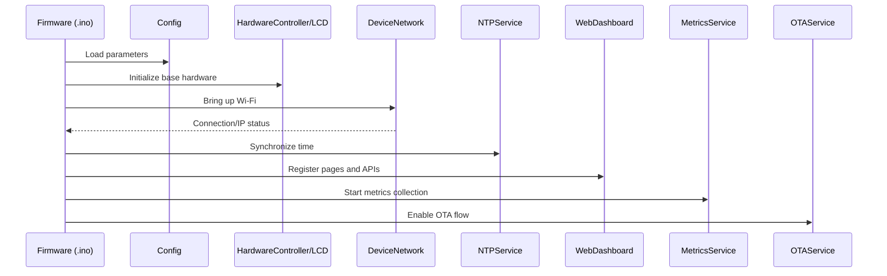
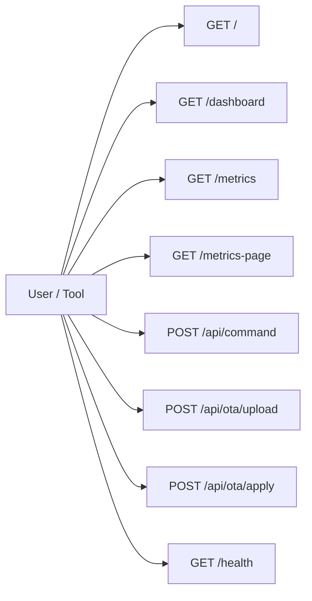
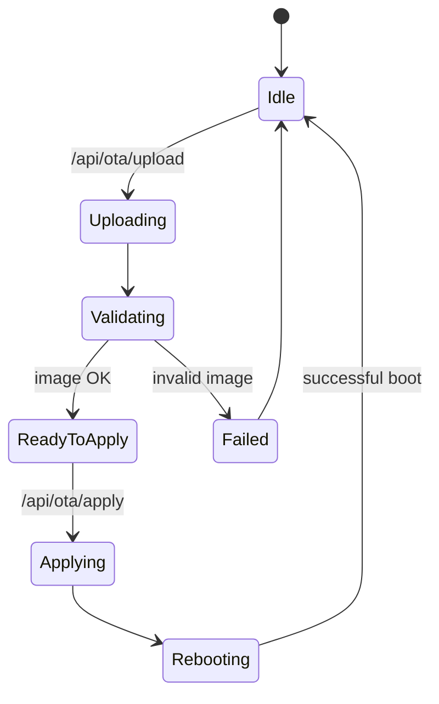
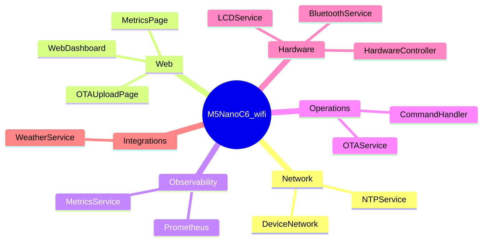

# M5NanoC6_wifi — Complete Technical Documentation

Modular firmware for **M5 Nano C6 (ESP32-C6)** focused on:
- Wi-Fi connectivity,
- local web dashboard,
- metrics/observability,
- OTA (remote updates),
- operational commands,
- auxiliary integrations (NTP, weather, Bluetooth, LCD).

---

## Table of Contents

1. [Repository identity](#1-repository-identity)
2. [High-level architecture](#2-high-level-architecture)
3. [Complete source file inventory](#3-complete-source-file-inventory-root-directory)
4. [Technical details by source file](#4-technical-details-by-source-file)
5. [API / likely routes](#5-api--likely-routes)
6. [Build, flashing, and validation](#6-build-flashing-and-validation-quick-guide)
7. [Observability and continuous operation](#7-observability-and-continuous-operation)
8. [Minimum recommended security](#8-minimum-recommended-security)
9. [Additional documentation files](#9-additional-documentation-files-in-the-repository)
10. [Recommended next upgrades](#10-recommended-next-upgrades)
11. [License](#license)

---

## 1) Repository identity

- **Repository:** `paulocfmarques-collab/M5NanoC6_wifi`
- **URL:** https://github.com/paulocfmarques-collab/M5NanoC6_wifi
- **Default branch:** `main`
- **Primary language:** C++
- **Target platform:** ESP32-C6 (Arduino framework)
- **Entrypoint:** `M5NanoC6_wifi.ino`

---

## 2) High-level architecture

The project follows a modular approach, with specialized services in C++ headers and a main orchestrator in `.ino`.

### 2.1 Component map

### 2.2 Boot sequence

### 2.3 Execution flow

1. Firmware boot (`setup` in `.ino`)
2. Parameter loading (`Config.h`)
3. Basic hardware initialization (`HardwareController.h`, `LCDService.h`)
4. Network connection (`DeviceNetwork.h`)
5. Time synchronization (`NTPService.h`)
6. Endpoint/page startup (`WebDashboard.h`, `MetricsPage.h`, `OTAUploadPage.h`)
7. Main loop (`loop`) with:
   - connectivity maintenance,
   - metrics collection and exposure,
   - command processing,
   - OTA supervision.

---

## 3) Complete source file inventory (root directory)

> Scope of this section: **code/configuration files** used by the firmware.

| File | Main function | Size (bytes) |
|---|---|---:|
| `M5NanoC6_wifi.ino` | Setup/loop orchestration of the application | 3080 |
| `Config.h` | Global configuration and parameter definitions | 4850 |
| `DeviceNetwork.h` | Wi-Fi management, network state, and reconnection | 32646 |
| `WebDashboard.h` | Local web dashboard and UI routes | 24901 |
| `CommandHandler.h` | Command processing and routing | 14622 |
| `MetricsService.h` | Metrics collection and exposure | 13660 |
| `MetricsPage.h` | Metrics visualization page | 6211 |
| `OTAService.h` | OTA update service | 6934 |
| `OTAUploadPage.h` | OTA firmware upload page | 3426 |
| `NTPService.h` | Time synchronization via NTP | 3713 |
| `WeatherService.h` | Weather data integration | 11595 |
| `BluetoothService.h` | Bluetooth connectivity/interaction features | 6952 |
| `LCDService.h` | LCD display rendering/control | 5745 |
| `HardwareController.h` | Peripheral/IO access and control | 5971 |
| `partitions.csv` | Flash partition layout (ESP32) | 304 |

---

## 4) Technical details by source file

## `M5NanoC6_wifi.ino`
**Role:** firmware entry point.  
**Likely responsibilities:**
- include/instantiate services,
- general initialization in `setup()`,
- maintenance cycle in `loop()`.

## `Config.h`
**Role:** centralize build/runtime parameters.  
**Expected content:** SSID/password, timeouts, debug flags, endpoints, and limits.

## `DeviceNetwork.h`
**Role:** connectivity layer.  
**Responsibilities:** start Wi-Fi, monitor link/RSSI, reconnect, maintain IP state.

## `WebDashboard.h`
**Role:** local web interface for operation.  
**Responsibilities:** serve HTML pages and HTTP handlers for status/control.

## `CommandHandler.h`
**Role:** operational command bus.  
**Responsibilities:** validate payloads, dispatch actions, and return standardized status responses.

## `MetricsService.h`
**Role:** technical observability.  
**Responsibilities:** collect and expose metrics (uptime, memory, Wi-Fi, errors).

## `MetricsPage.h`
**Role:** human-friendly metrics visualization.  
**Responsibilities:** render monitoring dashboard for quick troubleshooting.

## `OTAService.h`
**Role:** OTA update engine.  
**Responsibilities:** receive image, validate, apply, and coordinate reboot.

## `OTAUploadPage.h`
**Role:** web interface for OTA upload.  
**Responsibilities:** firmware upload and progress/error feedback.

## `NTPService.h`
**Role:** clock synchronization via NTP.  
**Impact:** reliable timestamps for logs and metrics.

## `WeatherService.h`
**Role:** weather integration.  
**Responsibilities:** query external source, cache, and fallback behavior.

## `BluetoothService.h`
**Role:** Bluetooth/BLE layer complementary to Wi-Fi.  
**Considerations:** radio concurrency and power consumption.

## `LCDService.h`
**Role:** local display output.  
**Responsibilities:** operational status and alert messages.

## `HardwareController.h`
**Role:** hardware/peripheral abstraction.  
**Benefit:** reduces coupling and eases codebase evolution.

## `partitions.csv`
**Role:** ESP32-C6 flash layout.  
**Critical for OTA:** must keep suitable partitioning for app and updates.

---

## 5) API / likely routes

> Routes inferred from module structure; adjust according to actual implementation.

### 5.1 Visual route map

### 5.2 Web pages

- `GET /` — initial dashboard
- `GET /dashboard` — overview
- `GET /metrics-page` — human-readable metrics
- `GET /ota` — firmware upload

### 5.3 Status/metrics API

- `GET /health` — health check
- `GET /status` — JSON snapshot
- `GET /metrics` — scraping/Prometheus endpoint

### 5.4 Operational API

- `POST /api/command` — general commands
- `POST /api/reboot` — reboot
- `POST /api/wifi/reconnect` — network reconnection
- `POST /api/time/sync` — NTP synchronization

### 5.5 OTA API

- `GET /api/ota/status`
- `POST /api/ota/upload`
- `POST /api/ota/apply`
- `POST /api/ota/cancel`

### 5.6 OTA state (conceptual)

---

## 6) Build, flashing, and validation (quick guide)

1. Install ESP32 support targeting ESP32-C6.
2. Open `M5NanoC6_wifi.ino`.
3. Review `Config.h`.
4. Confirm `partitions.csv` is OTA-compatible.
5. Build and flash.
6. Validate:
   - Wi-Fi connected,
   - dashboard reachable,
   - NTP synchronized,
   - metrics available,
   - OTA functional.

---

## 7) Observability and continuous operation

### 7.1 Observation domains

### 7.2 Items to monitor

- uptime,
- RSSI,
- free memory,
- error rate per module,
- NTP and OTA status.

---

## 8) Minimum recommended security

For critical endpoints (`/api/command`, OTA):
- API token/key,
- LAN restriction,
- strict payload and firmware validation,
- audit logs for sensitive commands.

---

## 9) Additional documentation files in the repository

Besides source files, the project includes:

- `CHANGELOG.md` and `CHANGELOG.pdf`
- `COMANDOS.md` and `COMANDOS.pdf`
- `OTA.md` and `OTA.pdf`
- `PROMETHEUS.md` and `PROMETHEUS.pdf`

---

## 10) Recommended next upgrades

- official architecture diagram with contracts between modules,
- complete `Config.h` parameter table,
- symptom-based troubleshooting section,
- standardized JSON responses across all routes,
- version compatibility matrix (board/framework/libs).

---

## License

No `LICENSE` file was identified at the root during this review.  
It is recommended to add an explicit license to define usage/distribution terms.
