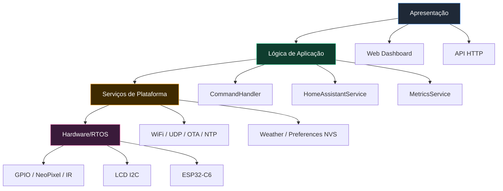
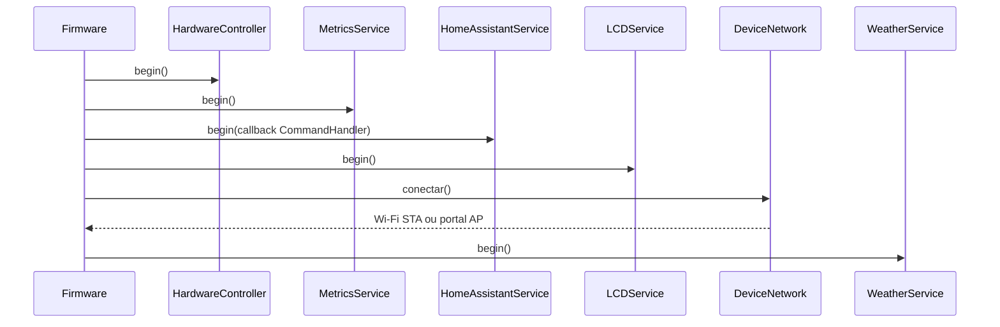
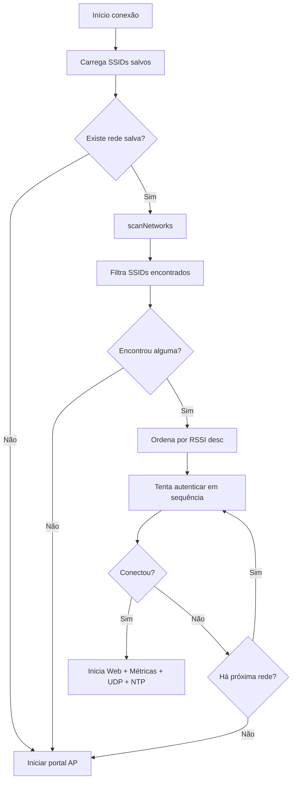
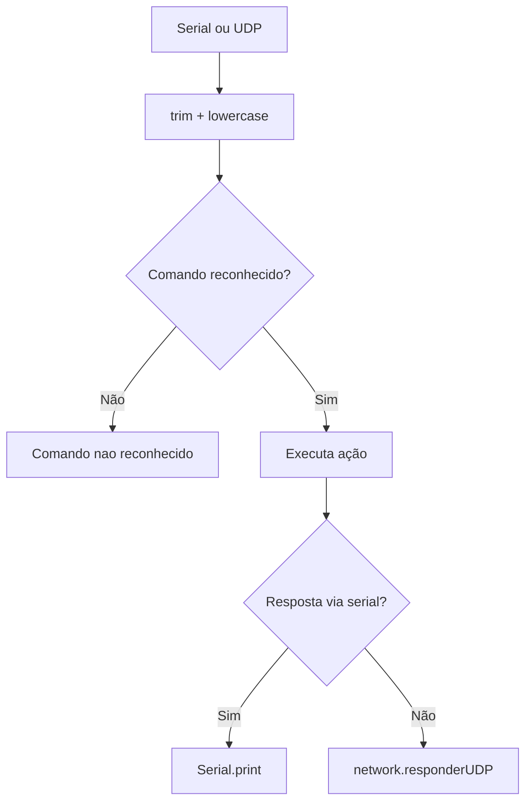
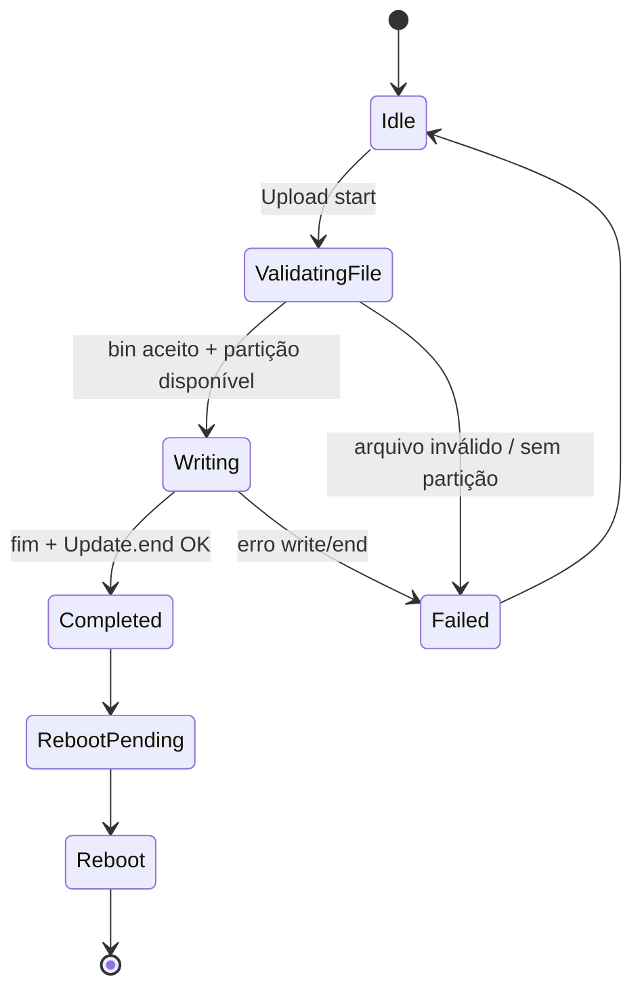
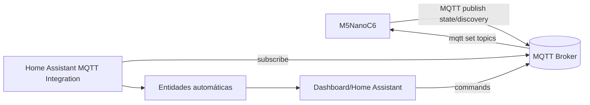
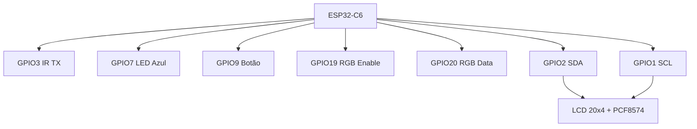
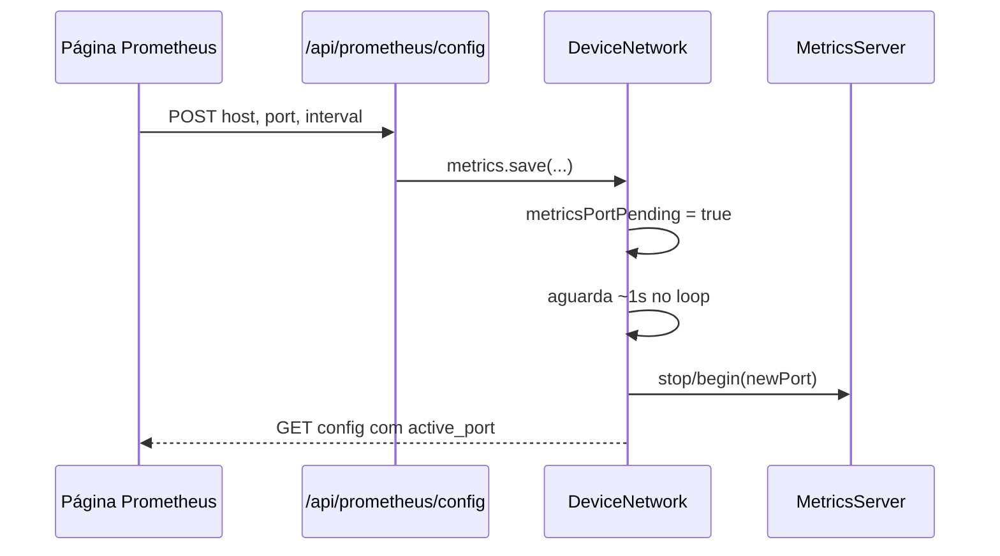
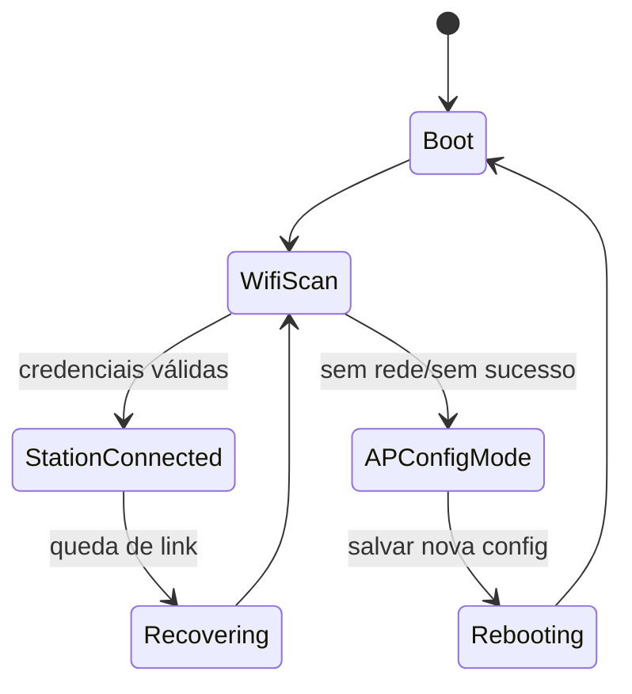

# M5NanoC6 Wi-Fi Firmware · Premium Technical README


Firmware modular para **M5NanoC6 (ESP32-C6)** com foco em confiabilidade operacional, observabilidade e integração residencial/IoT.

- Provisionamento Wi-Fi multi-rede por prioridade de sinal (RSSI)
- Dashboard web completo com API local
- OTA por HTTP e ArduinoOTA
- Métricas Prometheus + integração Home Assistant (MQTT Discovery)
- Comandos por Serial e UDP
- LCD 20x4 I²C, LED RGB, IR TX e monitoramento NTP/clima

---

## 📚 Sumário

1. [Visão geral](#-visão-geral)
2. [Arquitetura](#-arquitetura)
3. [Boot e ciclo de execução](#-boot-e-ciclo-de-execução)
4. [Inventário completo do repositório](#-inventário-completo-do-repositório)
5. [Rede e conectividade](#-rede-e-conectividade)
6. [Dashboard e API HTTP](#-dashboard-e-api-http)
7. [Comandos (Serial/UDP)](#-comandos-serialudp)
8. [OTA](#-ota)
9. [Prometheus](#-prometheus)
10. [Home Assistant / MQTT](#-home-assistant--mqtt)
11. [Hardware, pinos e periféricos](#-hardware-pinos-e-periféricos)
12. [Build e gravação](#-build-e-gravação)
13. [Particionamento](#-particionamento)
14. [Fluxos Mermaid extras](#-fluxos-mermaid-extras)
15. [Documentação auxiliar no repositório](#-documentação-auxiliar-no-repositório)

---

## 🔭 Visão geral

- **Repositório:** `paulocfmarques-collab/M5NanoC6_wifi`
- **URL:** https://github.com/paulocfmarques-collab/M5NanoC6_wifi
- **Branch padrão:** `main`
- **Linguagem principal:** C++ (Arduino core para ESP32)
- **Entry point:** `M5NanoC6_wifi.ino`

### Principais serviços globais instanciados

- `HardwareController hardware;`
- `DeviceNetwork network;`
- `NTPService ntp;`
- `LCDService lcd;`
- `WeatherService clima;`
- `MetricsService metrics;`
- `HomeAssistantService homeassistant;`

---

## 🧠 Arquitetura


### Camadas funcionais



---

## 🚀 Boot e ciclo de execução

### Sequência de inicialização



### Loop principal

```mermaid
flowchart TD
    L0[loop()] --> L1[network.processarWebServer]
    L1 --> L2[processarSerial]
    L2 --> L3[processarBotao]
    L3 --> L4[metrics.update]
    L4 --> L5[hardware.atualizarEfeitos]
    L5 --> L6[network.monitorarConexao]
    L6 --> L7[ntp.atualizar]
    L7 --> L8[lcd.atualizar]
    L8 --> L9[homeassistant.update]
    L9 --> L10{UDP chegou?}
    L10 -- Sim --> L11[CommandHandler::executar]
    L10 -- Não --> L12[delay(1)]
    L11 --> L12
    L12 --> L0
```

---

## 🗂️ Inventário completo do repositório

### Código e configuração (raiz)

| Arquivo | Papel principal |
|---|---|
| `M5NanoC6_wifi.ino` | Orquestra setup/loop e integra serviços |
| `Config.h` | Constantes de pinos, rede, clima, utilitários e HTML de config |
| `DeviceNetwork.h` | Wi-Fi/AP portal, servidor web, rotas, UDP, varredura RSSI |
| `CommandHandler.h` | Parser/dispatcher de comandos Serial+UDP |
| `HardwareController.h` | Controle de GPIO/LED/IR e efeitos |
| `LCDService.h` | Gerência do LCD 20x4 I²C |
| `LCDButton.h` | Lógica de botão (wake/next/off) |
| `NTPService.h` | Sincronização de tempo e estado NTP |
| `WeatherService.h` | Clima via Open-Meteo |
| `OTAService.h` | OTA HTTP + ArduinoOTA |
| `OTAUploadPage.h` | Formulário de upload OTA |
| `WebDashboard.h` | HTML/JS do painel principal |
| `MetricsService.h` | Coleta e exposição de métricas |
| `MetricsPage.h` | UI de configuração/consulta Prometheus |
| `HomeAssistantService.h` | Integração MQTT Discovery/Home Assistant |
| `HomeAssistantPage.h` | UI de configuração Home Assistant |
| `BluetoothService.h` | Serviço BLE UART-like (com fila e sessões) |
| `partitions.csv` | Tabela de partições ESP32-C6 |

### Documentação adicional

| Arquivo | Assunto |
|---|---|
| `CHANGELOG.md` / `CHANGELOG.pdf` | Histórico de alterações |
| `COMANDOS.md` / `COMANDOS.pdf` | Referência de comandos e uso |
| `OTA.md` / `OTA.pdf` | Fluxo e instruções de atualização OTA |
| `PROMETHEUS.md` / `PROMETHEUS.pdf` | Exposição de métricas e configuração |
| `HOME_ASSISTANT.md` / `HOME_ASSISTANT.pdf` | Integração MQTT com Home Assistant |

---

## 🌐 Rede e conectividade

### Estratégia de conexão Wi-Fi

- Armazena até **5 redes** em Preferences (`m5wifi`)
- Faz scan local e tenta conexão na ordem de **maior RSSI**
- Salva índice da última rede conectada com sucesso
- Se nenhuma rede válida estiver disponível, entra em **modo AP**: `M5NanoC6_CONFIG`



### Monitoramento de queda

- A cada ~10s, valida `WiFi.status()`
- Em queda:
  - para listener UDP
  - atualiza estado de métrica UDP listener
  - sinaliza visualmente
  - reinicia varredura circular de reconexão

---

## 🖥️ Dashboard e API HTTP

### Rotas principais identificadas

#### Interface
- `GET /` (portal config em AP, painel em STA)
- `GET /info`
- `GET /config`
- `GET /prometheus`
- `GET /homeassistant`
- `GET /ota`

#### Estado/configuração
- `GET /api/status`
- `GET /api/prometheus/config`
- `POST /api/prometheus/config`
- `GET /api/homeassistant/config`
- `POST /api/homeassistant/config`
- `GET /prometheus.yml`

#### Ações
- `POST /salvar` (salva redes e reinicia)
- `POST /ntp_sync`
- `POST /scan_wifi`
- `POST /set_fuso`
- `GET /reboot`
- `GET /led_on`
- `GET /led_off`
- `GET /ir_tx`
- `POST /lcd_on`
- `POST /lcd_off`

#### Métricas
- `GET /metrics` (porta 80 ou porta dedicada configurada)

### Mapa de navegação web

```mermaid
flowchart LR
    U[Usuário navegador] --> ROOT[/]
    ROOT --> INFO[/info]
    ROOT --> CFG[/config]
    INFO --> PROMUI[/prometheus]
    INFO --> HAUI[/homeassistant]
    INFO --> OTA[/ota]

    INFO --> APISTATUS[/api/status]
    PROMUI --> APIPROMGET[/api/prometheus/config GET]
    PROMUI --> APIPROMPOST[/api/prometheus/config POST]
    HAUI --> APIHAGET[/api/homeassistant/config GET]
    HAUI --> APIHAPOST[/api/homeassistant/config POST]
```

---

## ⌨️ Comandos (Serial/UDP)

- Entrada serial: 115200 baud
- Entrada UDP: porta **4210**
- Comandos normalizados para lower-case

### Comandos suportados (CommandHandler)

`help`, `info`, `status`, `version`, `build`, `reason`, `reboot`, `reset_counters`, `reset_wifi`, `alive`, `name`, `ha_user`, `ha_password`, `ha_status`, `ha_discovery`, `temp`, `cpu`, `ram`, `heap`, `flash`, `uptime`, `net_info`, `mac`, `rssi`, `ip`, `time`, `date`, `set_fuso:N`, `dst_on`, `dst_off`, `ntp_sync`, `ntp_status`, `led_on`, `led_off`, `led_blink[:ms]`, `set_rgb:R,G,B`, `set_breath:R,G,B,MS`, `lcd_on`, `lcd_off`, `ir_tx`.

### Fluxo de comando



---

## 🔁 OTA

### Capacidades OTA

- HTTP upload em `/ota`
- ArduinoOTA na porta **3232**, hostname `M5NanoC6`
- Sem senha OTA (conforme implementação atual)
- Validação de arquivo `.ino.bin` (rejeita bootloader/partitions/merged)
- Verifica capacidade da partição OTA antes de aceitar upload

### Estado OTA



---

## 📈 Prometheus

Com base na implementação e na documentação do repositório (`PROMETHEUS.md`):

- Endpoint `/metrics` em formato Prometheus 0.0.4
- Porta de métricas configurável e independente da UI (porta 80)
- Configuração persistida em namespace `telemetry`
- Geração de `prometheus.yml` via endpoint dedicado
- Métricas de rede, sistema, heap, uptime, HTTP, UDP, NTP, clima, MQTT

### Fluxo de coleta (pull)

```mermaid
sequenceDiagram
    participant P as Prometheus Server
    participant E as ESP32 (MetricsService)

    P->>E: GET /metrics
    E-->>P: text/plain; version=0.0.4
    P->>P: Armazena séries
    P->>P: Regras/alertas/dashboards
```

---

## 🏠 Home Assistant / MQTT

Com base em `HOME_ASSISTANT.md`:

- Integração via **MQTT Discovery** (prefixo `homeassistant`)
- Configuração por `/homeassistant`
- Persistência em namespace NVS `m5ha`
- Discovery + availability + state
- Comandos MQTT específicos para LCD/LED/NTP/IR

### Topologia HA



---

## 🔌 Hardware, pinos e periféricos

### Pinos principais (`Config.h`)

- `GPIO3` → IR TX
- `GPIO7` → LED azul status
- `GPIO9` → botão usuário
- `GPIO19` → enable NeoPixel bus
- `GPIO20` → dados LED RGB
- `GPIO2` → SDA LCD
- `GPIO1` → SCL LCD

### Outros parâmetros

- UDP: `4210`
- Fuso padrão: `-3` (Brasília)
- Clima padrão: Porto Alegre (`lat -30.03283`, `lon -51.23019`)

### Mapa de periféricos



---

## 🛠️ Build e gravação

### Pré-requisitos

- Arduino IDE ou PlatformIO com suporte ESP32-C6
- Bibliotecas usadas no projeto:
  - `ArduinoJson`
  - `PubSubClient` (integração HA/MQTT)
  - dependências do core ESP32 (`WiFi`, `WebServer`, `Update`, `ArduinoOTA`, etc.)

### Passos sugeridos

1. Abrir `M5NanoC6_wifi.ino`
2. Confirmar placa/alvo ESP32-C6
3. Compilar
4. Gravar por USB (especialmente primeira carga com partições OTA)
5. Acessar painel pelo IP obtido

---

## 💾 Particionamento

- O projeto possui `partitions.csv`
- OTA exige esquema com segunda partição de app válida
- Caso não haja partição OTA, a UI/serviço informa necessidade de gravação USB inicial

```mermaid
flowchart LR
    F[Flash] --> B[Bootloader]
    F --> T[Partition Table]
    F --> A0[App Slot A (running)]
    F --> A1[App Slot B (next OTA)]
    F --> NVS[NVS / Preferences]
    F --> O[Outras partições]
```

---

## 🔬 Fluxos Mermaid extras

### Fluxo de mudança de porta de métricas



### Máquina de estados de conectividade



---

## 📎 Documentação auxiliar no repositório

Para detalhes operacionais específicos, consulte também:

- [`COMANDOS.md`](./COMANDOS.md)
- [`OTA.md`](./OTA.md)
- [`PROMETHEUS.md`](./PROMETHEUS.md)
- [`HOME_ASSISTANT.md`](./HOME_ASSISTANT.md)
- [`CHANGELOG.md`](./CHANGELOG.md)

---

## ✅ Observações finais

Este README foi atualizado para refletir as informações técnicas presentes no repositório atual, com foco em:

- cobertura funcional ampla,
- documentação de rotas/fluxos,
- operação em produção local,
- visualização arquitetural com múltiplos diagramas Mermaid.

Se quiser, no próximo passo eu também posso:
1. gerar uma versão **EN-US** deste README;
2. adicionar seção de **troubleshooting por sintomas**;
3. incluir uma matriz de **compatibilidade (core ESP32 x bibliotecas)**.
