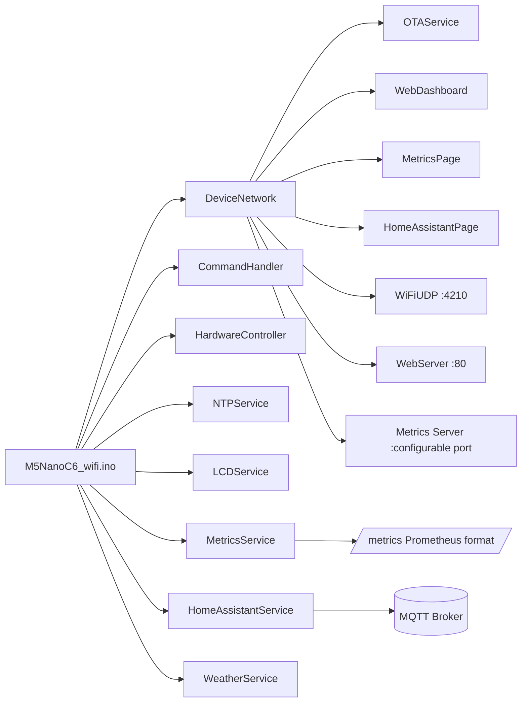
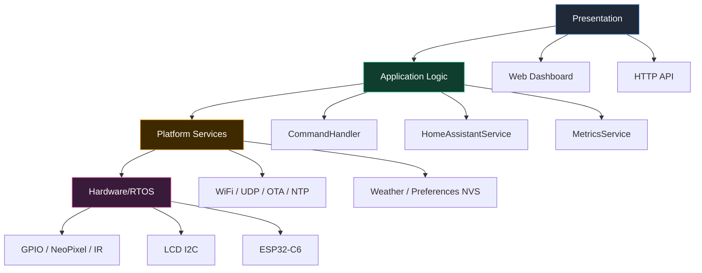
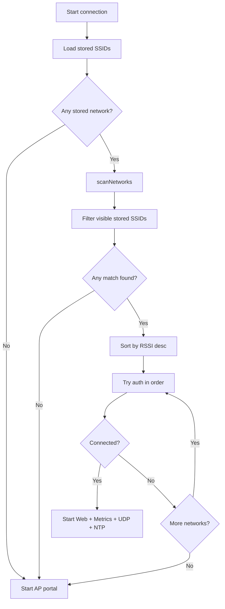
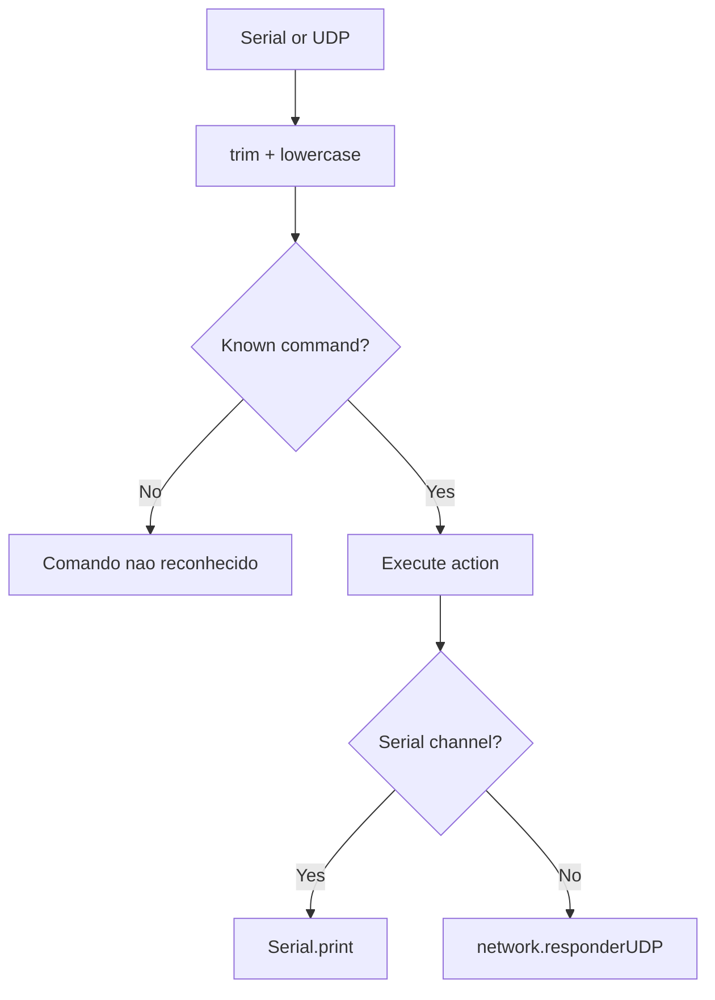
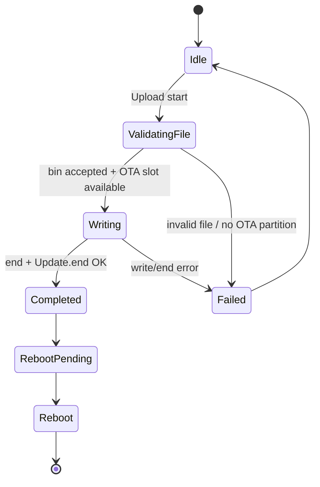
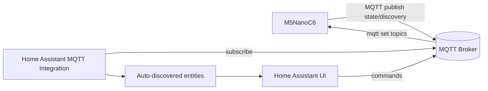
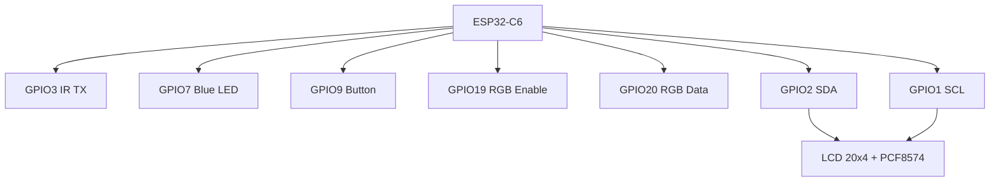
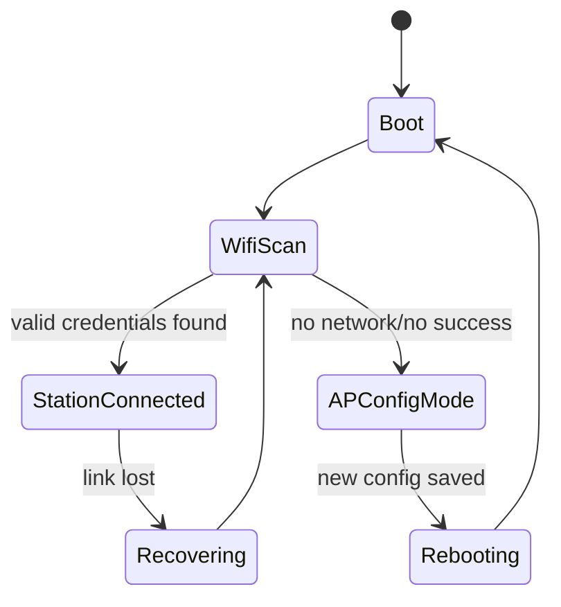

# M5NanoC6 Wi-Fi Firmware · Premium Technical README


Modular firmware for **M5NanoC6 (ESP32-C6)** focused on operational reliability, observability, and smart-home/IoT integration.

- Multi-network Wi-Fi provisioning with RSSI-based priority
- Complete local web dashboard + API
- OTA updates via HTTP and ArduinoOTA
- Prometheus metrics + Home Assistant integration (MQTT Discovery)
- Serial and UDP command channels
- 20x4 I²C LCD, RGB LED, IR TX, NTP, and weather monitoring

---

## 📚 Table of Contents

1. [Overview](#-overview)
2. [Architecture](#-architecture)
3. [Boot and execution cycle](#-boot-and-execution-cycle)
4. [Complete repository inventory](#-complete-repository-inventory)
5. [Networking and connectivity](#-networking-and-connectivity)
6. [Dashboard and HTTP API](#-dashboard-and-http-api)
7. [Commands (Serial/UDP)](#-commands-serialudp)
8. [OTA](#-ota)
9. [Prometheus](#-prometheus)
10. [Home Assistant / MQTT](#-home-assistant--mqtt)
11. [Hardware, pins, and peripherals](#-hardware-pins-and-peripherals)
12. [Build and flashing](#-build-and-flashing)
13. [Partitioning](#-partitioning)
14. [Extra Mermaid flows](#-extra-mermaid-flows)
15. [Additional documentation in the repository](#-additional-documentation-in-the-repository)

---

## 🔭 Overview

- **Repository:** `paulocfmarques-collab/M5NanoC6_wifi`
- **URL:** https://github.com/paulocfmarques-collab/M5NanoC6_wifi
- **Default branch:** `main`
- **Primary language:** C++ (Arduino core for ESP32)
- **Entry point:** `M5NanoC6_wifi.ino`

### Main global services instantiated

- `HardwareController hardware;`
- `DeviceNetwork network;`
- `NTPService ntp;`
- `LCDService lcd;`
- `WeatherService clima;`
- `MetricsService metrics;`
- `HomeAssistantService homeassistant;`

---

## 🧠 Architecture



### Functional layers



---

## 🚀 Boot and execution cycle

### Initialization sequence


### Main loop

```mermaid
flowchart TD
    L0[loop()] --> L1[network.processarWebServer]
    L1 --> L2[processarSerial]
    L2 --> L3[processarBotao]
    L3 --> L4[metrics.update]
    L4 --> L5[hardware.atualizarEfeitos]
    L5 --> L6[network.monitorarConexao]
    L6 --> L7[ntp.atualizar]
    L7 --> L8[lcd.atualizar]
    L8 --> L9[homeassistant.update]
    L9 --> L10{UDP message received?}
    L10 -- Yes --> L11[CommandHandler::executar]
    L10 -- No --> L12[delay(1)]
    L11 --> L12
    L12 --> L0
```

---

## 🗂️ Complete repository inventory

### Code and configuration (root)

| File | Main purpose |
|---|---|
| `M5NanoC6_wifi.ino` | Orchestrates setup/loop and service integration |
| `Config.h` | Pin constants, network/weather defaults, helpers, and config HTML |
| `DeviceNetwork.h` | Wi-Fi/AP portal, web server, routes, UDP, RSSI scan/reconnect |
| `CommandHandler.h` | Serial/UDP command parser and dispatcher |
| `HardwareController.h` | GPIO/LED/IR control and effects |
| `LCDService.h` | I²C 20x4 LCD lifecycle and rendering |
| `LCDButton.h` | Button behavior (wake/next/off) |
| `NTPService.h` | Time synchronization and NTP status |
| `WeatherService.h` | Open-Meteo weather integration |
| `OTAService.h` | HTTP OTA + ArduinoOTA |
| `OTAUploadPage.h` | OTA upload form UI |
| `WebDashboard.h` | Main dashboard HTML/JS |
| `MetricsService.h` | Metric collection and exposition |
| `MetricsPage.h` | Prometheus configuration/status page |
| `HomeAssistantService.h` | MQTT Discovery/Home Assistant integration |
| `HomeAssistantPage.h` | Home Assistant configuration UI |
| `BluetoothService.h` | BLE UART-like service with queued sessions |
| `partitions.csv` | ESP32-C6 partition table |

### Additional documentation

| File | Topic |
|---|---|
| `CHANGELOG.md` / `CHANGELOG.pdf` | Change history |
| `COMANDOS.md` / `COMANDOS.pdf` | Command reference and usage |
| `OTA.md` / `OTA.pdf` | OTA workflow and instructions |
| `PROMETHEUS.md` / `PROMETHEUS.pdf` | Metrics exposition and setup |
| `HOME_ASSISTANT.md` / `HOME_ASSISTANT.pdf` | MQTT/Home Assistant integration |

---

## 🌐 Networking and connectivity

### Wi-Fi strategy

- Stores up to **5 networks** in Preferences (`m5wifi`)
- Scans nearby APs and attempts connection by **strongest RSSI first**
- Saves index of the last successful network
- Falls back to **AP mode** (`M5NanoC6_CONFIG`) when no valid network is reachable



### Connection loss recovery

- Every ~10s, checks `WiFi.status()`
- On disconnect:
  - stops UDP listener
  - updates UDP listener metric status
  - signals visually
  - restarts circular reconnection scan

---

## 🖥️ Dashboard and HTTP API

### Main routes identified

#### UI
- `GET /` (config portal in AP mode, dashboard in STA mode)
- `GET /info`
- `GET /config`
- `GET /prometheus`
- `GET /homeassistant`
- `GET /ota`

#### Status/configuration
- `GET /api/status`
- `GET /api/prometheus/config`
- `POST /api/prometheus/config`
- `GET /api/homeassistant/config`
- `POST /api/homeassistant/config`
- `GET /prometheus.yml`

#### Actions
- `POST /salvar` (save networks and reboot)
- `POST /ntp_sync`
- `POST /scan_wifi`
- `POST /set_fuso`
- `GET /reboot`
- `GET /led_on`
- `GET /led_off`
- `GET /ir_tx`
- `POST /lcd_on`
- `POST /lcd_off`

#### Metrics
- `GET /metrics` (port 80 or dedicated configured port)

### Web navigation map

```mermaid
flowchart LR
    U[Browser User] --> ROOT[/]
    ROOT --> INFO[/info]
    ROOT --> CFG[/config]
    INFO --> PROMUI[/prometheus]
    INFO --> HAUI[/homeassistant]
    INFO --> OTA[/ota]

    INFO --> APISTATUS[/api/status]
    PROMUI --> APIPROMGET[/api/prometheus/config GET]
    PROMUI --> APIPROMPOST[/api/prometheus/config POST]
    HAUI --> APIHAGET[/api/homeassistant/config GET]
    HAUI --> APIHAPOST[/api/homeassistant/config POST]
```

---

## ⌨️ Commands (Serial/UDP)

- Serial input: 115200 baud
- UDP input: port **4210**
- Commands are normalized to lowercase

### Supported commands (CommandHandler)

`help`, `info`, `status`, `version`, `build`, `reason`, `reboot`, `reset_counters`, `reset_wifi`, `alive`, `name`, `ha_user`, `ha_password`, `ha_status`, `ha_discovery`, `temp`, `cpu`, `ram`, `heap`, `flash`, `uptime`, `net_info`, `mac`, `rssi`, `ip`, `time`, `date`, `set_fuso:N`, `dst_on`, `dst_off`, `ntp_sync`, `ntp_status`, `led_on`, `led_off`, `led_blink[:ms]`, `set_rgb:R,G,B`, `set_breath:R,G,B,MS`, `lcd_on`, `lcd_off`, `ir_tx`.

### Command flow



---

## 🔁 OTA

### OTA capabilities

- HTTP upload endpoint at `/ota`
- ArduinoOTA on port **3232**, hostname `M5NanoC6`
- No OTA password in current implementation
- Validates `.ino.bin` payload (rejects bootloader/partitions/merged)
- Checks OTA partition capacity before accepting upload

### OTA state machine



---

## 📈 Prometheus

Based on implementation + `PROMETHEUS.md`:

- `/metrics` in Prometheus 0.0.4 exposition format
- Metrics port configurable and independent from web UI (port 80)
- Configuration persisted in `telemetry` namespace
- `prometheus.yml` generated through dedicated endpoint
- Covers network, system, heap, uptime, HTTP, UDP, NTP, weather, MQTT

### Pull collection flow

```mermaid
sequenceDiagram
    participant P as Prometheus Server
    participant E as ESP32 (MetricsService)

    P->>E: GET /metrics
    E-->>P: text/plain; version=0.0.4
    P->>P: Store time series
    P->>P: Rules/alerts/dashboards
```

---

## 🏠 Home Assistant / MQTT

Based on `HOME_ASSISTANT.md`:

- Integration via **MQTT Discovery** (prefix `homeassistant`)
- Configured through `/homeassistant`
- Persistence in NVS namespace `m5ha`
- Discovery + availability + state topics
- Dedicated MQTT commands for LCD/LED/NTP/IR

### HA topology



---

## 🔌 Hardware, pins, and peripherals

### Main pin mapping (`Config.h`)

- `GPIO3` → IR TX
- `GPIO7` → Blue status LED
- `GPIO9` → User button
- `GPIO19` → NeoPixel bus enable
- `GPIO20` → RGB LED data
- `GPIO2` → LCD SDA
- `GPIO1` → LCD SCL

### Other defaults

- UDP port: `4210`
- Default timezone: `-3` (Brasília)
- Default weather target: Porto Alegre (`lat -30.03283`, `lon -51.23019`)

### Peripheral map



---

## 🛠️ Build and flashing

### Prerequisites

- Arduino IDE or PlatformIO with ESP32-C6 support
- Libraries used by the project:
  - `ArduinoJson`
  - `PubSubClient` (HA/MQTT integration)
  - ESP32 core dependencies (`WiFi`, `WebServer`, `Update`, `ArduinoOTA`, etc.)

### Suggested steps

1. Open `M5NanoC6_wifi.ino`
2. Select ESP32-C6 target board
3. Compile
4. Flash via USB (especially first deployment with OTA-capable partition layout)
5. Access dashboard using assigned IP

---

## 💾 Partitioning

- Repository includes `partitions.csv`
- OTA requires a valid second app slot
- If OTA partition is unavailable, firmware instructs USB flashing first

```mermaid
flowchart LR
    F[Flash] --> B[Bootloader]
    F --> T[Partition Table]
    F --> A0[App Slot A (running)]
    F --> A1[App Slot B (next OTA)]
    F --> NVS[NVS / Preferences]
    F --> O[Other partitions]
```

---

## 🔬 Extra Mermaid flows

### Metrics port change flow


### Connectivity state machine



---

## 📎 Additional documentation in the repository

For deeper operational details, see:

- [`COMANDOS.md`](./COMANDOS.md)
- [`OTA.md`](./OTA.md)
- [`PROMETHEUS.md`](./PROMETHEUS.md)
- [`HOME_ASSISTANT.md`](./HOME_ASSISTANT.md)
- [`CHANGELOG.md`](./CHANGELOG.md)
